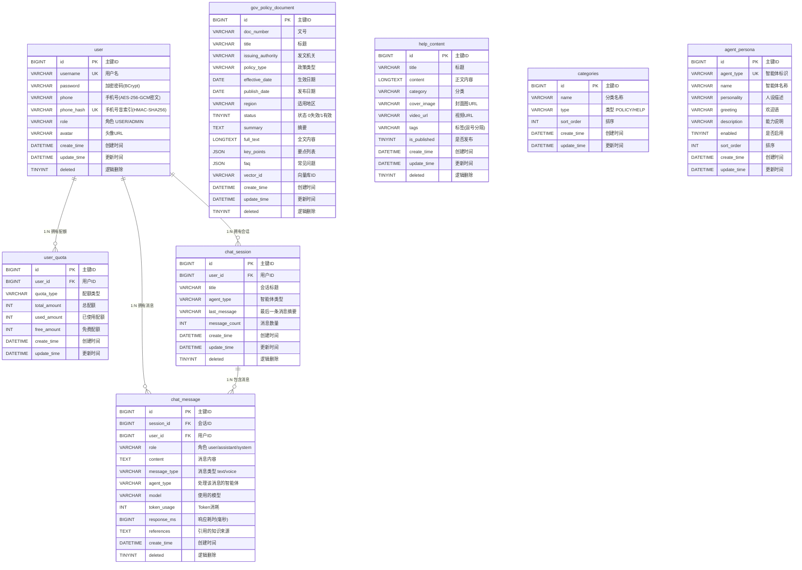
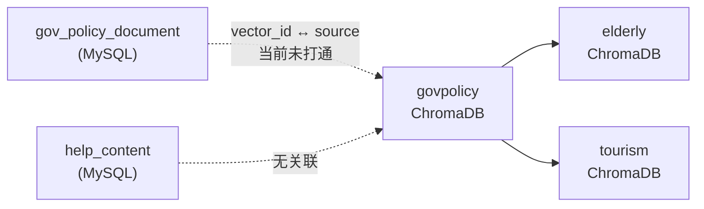

# 知伴AI 双端智能体平台 — 数据库设计文档

> **本文档依据源码实际实现编写，基线：`8653c06`**
>
> ⚠️ **基线说明**：`8653c06` 为编写时 `HEAD` 的提交哈希，
> 但当时工作区**存在未提交的改动**（`git status` 非干净）。
> 文档内容以**工作区实际文件**为准，并已在编写过程中核对到最新状态。
> 若后续源码有变更，请以源码为准并同步更新本文档。
>
> 编写方式：逐行阅读 `java-backend/src/main/resources/schema.sql`（生产 MySQL DDL，
> 含表注释、字段注释、索引与种子数据），并逐一比对
> `java-backend/src/main/java/com/zhiban/ai/entity/` 下全部 8 个实体类，
> 确认 DDL 列名与 Java 字段的映射关系；
> 同时阅读 `mapper/` 下的 Mapper 接口（含 `@Select`/`@Update` 原生 SQL）、
> `resources/application.yml`（MyBatis-Plus 全局配置），
> 以及 Python 侧 `python/config.py`、`python/knowledge_base/build_kb.py`
> 以说明 ChromaDB 向量库的集合划分。
> 凡与既有文档不一致之处，见文末 [§9 已知实现差异](#9-已知实现差异)。

---

## 目录

1. [数据库概览](#1-数据库概览)
2. [ER 图](#2-er-图)
3. [表结构详细设计](#3-表结构详细设计)
4. [表间关系说明](#4-表间关系说明)
5. [索引与约束汇总](#5-索引与约束汇总)
6. [逻辑删除与字段填充约定](#6-逻辑删除与字段填充约定)
7. [初始化种子数据](#7-初始化种子数据)
8. [ChromaDB 向量库设计](#8-chromadb-向量库设计)
9. [已知实现差异](#9-已知实现差异)

---

## 1. 数据库概览

### 1.1 基本信息

| 项 | 值 |
|---|---|
| 数据库类型 | MySQL 8 |
| 数据库名 | `zhiban_ai` |
| 字符集 | `utf8mb4` |
| 排序规则 | `utf8mb4_unicode_ci` |
| 存储引擎 | `InnoDB` |
| 初始化脚本 | `java-backend/src/main/resources/schema.sql` |
| 测试用脚本 | `java-backend/src/test/resources/schema-h2.sql`（H2 兼容版） |
| 连接串 | `jdbc:mysql://${DB_HOST:localhost}:${DB_PORT:3306}/${DB_NAME:zhiban_ai}?useUnicode=true&characterEncoding=utf-8&useSSL=false&serverTimezone=Asia/Shanghai&allowPublicKeyRetrieval=true` |
| 连接池 | HikariCP，`maximum-pool-size=20`，`minimum-idle=5` |

### 1.2 数据存储分层

本项目采用**关系库 + 向量库**双存储：

| 存储 | 技术 | 内容 | 说明 |
|---|---|---|---|
| 关系库 | MySQL 8 | 用户、配额、政策文档、帮助文章、分类、会话、消息、智能体人设 | 业务主数据与元数据 |
| 向量库 | ChromaDB | 三大方向知识库的文档切片向量 | 位于 `python/knowledge_base/chroma_db/`，按集合分目录 |

> **设计要点**：政策文档在 MySQL 中存**结构化元数据 + 全文**，
> 在 ChromaDB 中存**切片向量**，两者通过 `gov_policy_document.vector_id` 关联。
> 但当前实现中该关联**未真正打通**，详见 §9.3。

### 1.3 表清单

| # | 表名 | 中文名 | 记录数级 | 逻辑删除 | 实体类 |
|---|---|---|---|---|---|
| 1 | `user` | 用户表 | 万级 | ✅ | `User` |
| 2 | `user_quota` | 用户配额表 | 万级 | ❌ | `UserQuota` |
| 3 | `gov_policy_document` | 政策文档表 | 千级 | ✅ | `GovPolicyDocument` |
| 4 | `help_content` | 帮助内容表 | 千级 | ✅ | `HelpContent` |
| 5 | `categories` | 分类表 | 十级 | ❌ | `Category` |
| 6 | `chat_session` | 对话会话表 | 十万级 | ✅ | `ChatSession` |
| 7 | `chat_message` | 对话消息表 | 百万级 | ✅ | `ChatMessage` |
| 8 | `agent_persona` | 智能体人设表 | 3 条 | ❌ | `AgentPersona` |

> **注意**：8 张表与 8 个实体类**一一对应**，无实体缺失、无多余表。

### 1.4 命名约定

| 对象 | 约定 | 示例 |
|---|---|---|
| 表名 | 小写下划线，单数 | `user`、`chat_session` |
| 列名 | 小写下划线 | `create_time`、`is_published` |
| 主键 | 统一 `id`，`BIGINT AUTO_INCREMENT` | `id` |
| 主键索引 | `PRIMARY KEY` | — |
| 唯一索引 | `uk_` 前缀 | `uk_username`、`uk_agent_type` |
| 普通索引 | `idx_` 前缀 | `idx_policy_type`、`idx_session_create` |
| 时间列 | `create_time` / `update_time`，`DATETIME` | 均带 `DEFAULT CURRENT_TIMESTAMP` |
| 逻辑删除列 | `deleted`，`TINYINT` | `0`=未删除，`1`=已删除 |

**Java 字段映射**：`application.yml` 配置了
`mybatis-plus.configuration.map-underscore-to-camel-case: true`，
但所有实体类仍通过 `@TableField("列名")` **显式**标注了每个字段的列名，
属于「双保险」，映射关系完全确定。

---

## 2. ER 图



### 2.1 关系基数说明

| 关系 | 基数 | 外键列 | 数据库级外键约束 |
|---|---|---|---|
| `user` → `user_quota` | 1 : N（业务上按 `quota_type` 唯一，实际 1 : 1~N） | `user_quota.user_id` | ❌ 无 FK，仅索引 |
| `user` → `chat_session` | 1 : N | `chat_session.user_id` | ❌ 无 FK，仅索引 |
| `user` → `chat_message` | 1 : N | `chat_message.user_id` | ❌ 无 FK，仅索引 |
| `chat_session` → `chat_message` | 1 : N | `chat_message.session_id` | ❌ 无 FK，仅索引 |

> ⚠️ **重要**：`schema.sql` 中**没有任何 `FOREIGN KEY` 约束**，
> 所有「外键」均为**逻辑外键**（应用层维护 + 索引加速）。
> 引用完整性由 Service 层保证，例如 `ChatServiceImpl.requireOwnedSession()`
> 会校验会话归属，防止跨用户越权。
>
> `gov_policy_document`、`help_content`、`categories`、`agent_persona`
> 四张表与其他表**无关联**，属于独立的字典/内容表。

### 2.2 与向量库的关系



MySQL 中的政策文档与 ChromaDB 中的向量切片通过
`gov_policy_document.vector_id` 与向量元数据 `source`（文件名）**意图**关联，
但当前实现下二者取值口径不一致，见 §9.3。

---

## 3. 表结构详细设计

### 3.1 `user` — 用户表

**用途**：存储平台用户（含管理员、普通用户与自动创建的游客账号）。

**表注释**：`用户表`

| 列名 | 类型 | 可空 | 默认值 | 说明 |
|---|---|---|---|---|
| `id` | `BIGINT` | 否 | `AUTO_INCREMENT` | 主键 ID |
| `username` | `VARCHAR(64)` | 否 | — | 用户名（唯一） |
| `password` | `VARCHAR(128)` | 否 | — | 加密密码（BCrypt） |
| `phone` | `VARCHAR(255)` | 是 | `NULL` | 手机号（**AES-256-GCM 加密存储**，附件一 §8.1） |
| `phone_hash` | `VARCHAR(64)` | 是 | `NULL` | 手机号盲索引（HMAC-SHA256），用于加密后的等值查询 |
| `role` | `VARCHAR(20)` | 否 | `'USER'` | 角色：`USER` / `ADMIN` |
| `avatar` | `VARCHAR(512)` | 是 | `NULL` | 头像 URL |
| `create_time` | `DATETIME` | 否 | `CURRENT_TIMESTAMP` | 创建时间 |
| `update_time` | `DATETIME` | 否 | `CURRENT_TIMESTAMP ON UPDATE CURRENT_TIMESTAMP` | 更新时间 |
| `deleted` | `TINYINT` | 否 | `0` | 逻辑删除：`0`=未删除 `1`=已删除 |

**主键**：`PRIMARY KEY (id)`
**索引**：
- `UNIQUE KEY uk_username (username)`
- `UNIQUE KEY uk_user_phone_hash (phone_hash)`

**Java 映射**：`com.zhiban.ai.entity.User`（`@TableName("user")`）
所有字段均带 `@TableField`（含 `phoneHash` → `phone_hash`）；`deleted` 额外带 `@TableLogic`。

**业务说明**

- 用户名是唯一登录凭据；`role` 决定能否访问 `/api/admin/**`。
- **游客账号**：`AuthServiceImpl.guestLogin()` 每次调用创建一条记录，
  用户名格式 `guest_` + UUID 去横线后前 16 位；
  密码写入随机 UUID 的 BCrypt 值（不可用于登录）；`role = 'USER'`。
- **手机号首次登录自动注册**：用户名格式 `u` + 手机号。

**手机号加密存储（附件一 §8.1）**

由 `com.zhiban.ai.security.PhoneCryptoService` 实现：

| 项 | 说明 |
|---|---|
| 算法 | `AES/GCM/NoPadding`（AES-256-GCM），每条记录**独立随机 IV** |
| IV 长度 | 12 字节（`GCM_IV_BYTES`） |
| 认证标签 | 128 位（`GCM_TAG_BITS`） |
| 密文格式 | `enc1:base64(iv ‖ ciphertext ‖ tag)`，前缀 `enc1:` 用于区分历史明文 |
| 盲索引 | `HMAC-SHA256`，存于 `phone_hash`，用于密文下的**等值查询** |
| 密钥来源 | 环境变量 `PHONE_ENC_KEY` / `PHONE_INDEX_KEY` |
| 降级行为 | 未配置密钥时**退化为明文存储**并打印 WARN 告警（保证开发环境可用） |
| 历史兼容 | 无 `enc1:` 前缀的值按明文原样返回，支持灰度迁移 |

> **为什么需要 `phone_hash`**：GCM 是**非确定性加密**（每次 IV 不同），
> 同一手机号的密文每次都不同，无法直接用密文做 `WHERE phone = ?` 等值查询。
> 因此额外维护一个**确定性**的 HMAC 盲索引列专门用于查找。
> `uk_user_phone_hash` 唯一索引同时起到「防止同一手机号重复注册」的作用
> （MySQL 唯一索引允许多个 `NULL`，因此不影响未填手机号的用户）。

**典型查询**

```sql
-- 登录（UserMapper.selectByUsername）
SELECT id, username, password, phone, phone_hash, role, avatar, create_time, update_time
FROM user WHERE username = ? AND deleted = 0;

-- 手机号等值查询（UserMapper.selectByPhoneHash）——走盲索引，不走 phone 列
SELECT id, username, password, phone, phone_hash, role, avatar, create_time, update_time
FROM user WHERE phone_hash = ? AND deleted = 0;
```

**数据迁移**：存量环境（旧版 `phone VARCHAR(20)` 明文）使用
`java-backend/src/main/resources/migration/V1_1__phone_encryption.sql`
完成结构迁移（扩展列宽 + 新增 `phone_hash` 与唯一索引）。
该脚本**只做结构变更**，不在 SQL 层加密存量明文；
应用读取时对无 `enc1:` 前缀的值按明文处理，可按需做一次性加密回填。

---

### 3.2 `user_quota` — 用户配额表

**用途**：记录每个用户在各配额类型下的额度与消耗，用于政策问答限次。

**表注释**：`用户配额表`

| 列名 | 类型 | 可空 | 默认值 | 说明 |
|---|---|---|---|---|
| `id` | `BIGINT` | 否 | `AUTO_INCREMENT` | 主键 ID |
| `user_id` | `BIGINT` | 否 | — | 用户 ID |
| `quota_type` | `VARCHAR(32)` | 否 | — | 配额类型：`POLICY_QA` / `HELP_SEARCH` 等 |
| `total_amount` | `INT` | 否 | `0` | 总配额 |
| `used_amount` | `INT` | 否 | `0` | 已使用配额 |
| `free_amount` | `INT` | 否 | `0` | 免费配额 |
| `create_time` | `DATETIME` | 否 | `CURRENT_TIMESTAMP` | 创建时间 |
| `update_time` | `DATETIME` | 否 | `CURRENT_TIMESTAMP ON UPDATE CURRENT_TIMESTAMP` | 更新时间 |

**主键**：`PRIMARY KEY (id)`
**索引**：
- `UNIQUE KEY uk_user_quota_type (user_id, quota_type)`
- `INDEX idx_user_id (user_id)`

**Java 映射**：`com.zhiban.ai.entity.UserQuota`（`@TableName("user_quota")`）
**无逻辑删除列**，也无 `@TableLogic`。

**业务说明**

- **唯一约束是核心**：`(user_id, quota_type)` 唯一，保证一个用户一种类型只有一条记录。
- 剩余配额 = `total_amount - used_amount`，**不落库**，由 `QuotaVO.remainingAmount` 计算。
- 当前实际使用的配额类型只有 `POLICY_QA` 一种
  （`HelpCenterServiceImpl.QUOTA_TYPE_POLICY_QA`）。
- **默认额度**：`DEFAULT_TOTAL_QUOTA = 100`、`DEFAULT_FREE_QUOTA = 10`。

**关键 SQL（原子操作，`UserQuotaMapper`）**

原子扣减（避免并发超扣）：

```sql
UPDATE user_quota
SET used_amount = used_amount + 1,
    update_time = NOW()
WHERE user_id = #{userId}
  AND quota_type = #{quotaType}
  AND used_amount < total_amount
```

> 返回受影响行数：`1` = 扣减成功，`0` = 配额不足。
> **这是本项目防超扣的关键设计**——用单条 SQL 的条件更新替代「先读后写」，
> 避免了并发场景下的丢失更新。

幂等初始化：

```sql
INSERT IGNORE INTO user_quota
    (user_id, quota_type, total_amount, used_amount, free_amount, create_time, update_time)
VALUES (#{userId}, #{quotaType}, #{totalAmount}, 0, #{freeAmount}, NOW(), NOW())
```

**触发时机**：注册、游客登录、手机号首次登录、以及
`deductQuota` / `getQuotaByUserAndType` / `adjustQuota` 发现记录不存在时。

---

### 3.3 `gov_policy_document` — 政策文档表

**用途**：存储政策文件的结构化元数据与全文，是政策检索与问答的数据源。

**表注释**：`政策文档表`

| 列名 | 类型 | 可空 | 默认值 | 说明 |
|---|---|---|---|---|
| `id` | `BIGINT` | 否 | `AUTO_INCREMENT` | 主键 ID |
| `doc_number` | `VARCHAR(128)` | 是 | `NULL` | 文号 |
| `title` | `VARCHAR(512)` | 否 | — | 标题 |
| `issuing_authority` | `VARCHAR(256)` | 是 | `NULL` | 发文机关 |
| `policy_type` | `VARCHAR(64)` | 否 | — | 政策类型：养老/旅游/政务 等 |
| `effective_date` | `DATE` | 是 | `NULL` | 生效日期 |
| `publish_date` | `DATE` | 是 | `NULL` | 发布日期 |
| `region` | `VARCHAR(128)` | 是 | `NULL` | 适用地区 |
| `status` | `TINYINT` | 否 | `1` | 状态：`0`=失效 `1`=有效 |
| `summary` | `TEXT` | 是 | `NULL` | 摘要 |
| `full_text` | `LONGTEXT` | 是 | `NULL` | 全文内容 |
| `key_points` | `JSON` | 是 | `NULL` | 要点列表（JSON 数组） |
| `faq` | `JSON` | 是 | `NULL` | 常见问题（JSON 数组） |
| `vector_id` | `VARCHAR(128)` | 是 | `NULL` | 向量库 ID |
| `create_time` | `DATETIME` | 否 | `CURRENT_TIMESTAMP` | 创建时间 |
| `update_time` | `DATETIME` | 否 | `CURRENT_TIMESTAMP ON UPDATE CURRENT_TIMESTAMP` | 更新时间 |
| `deleted` | `TINYINT` | 否 | `0` | 逻辑删除：`0`=未删除 `1`=已删除 |

**主键**：`PRIMARY KEY (id)`
**索引**：
- `INDEX idx_policy_type (policy_type)`
- `INDEX idx_status (status)`
- `INDEX idx_region (region)`
- `INDEX idx_publish_date (publish_date)`

**Java 映射**：`com.zhiban.ai.entity.GovPolicyDocument`
（`@TableName("gov_policy_document")`）。注意 `keyPoints` 与 `faq`
在 Java 侧是 **`String`**（JSON 字符串），在返回给前端时才解析为数组。

**JSON 字段格式**

```json
"key_points": ["要点一", "要点二"]
```

```json
"faq": [
  { "question": "高龄补贴如何申请？", "answer": "……" }
]
```

> `GovPolicyVO.FaqItem` 定义了 `question` / `answer` 两个属性；
> 解析失败时 `HelpCenterServiceImpl` 返回空集合而非抛异常。

**状态语义**：`status = 1`（有效）是绝大多数查询的前置条件——
`selectByVectorIds`、`selectFaqList` 均硬编码 `status = 1`。

**关键 SQL（`GovPolicyDocumentMapper`）**

分页查询（动态条件，`@Select` + `<script>`）：

```sql
SELECT id, doc_number, title, issuing_authority, policy_type,
       effective_date, publish_date, region, status, summary,
       full_text, key_points, faq, vector_id, create_time, update_time
FROM gov_policy_document
WHERE deleted = 0
  -- 可选：AND policy_type = #{policyType}
  -- 可选：AND (title LIKE ... OR summary LIKE ... OR issuing_authority LIKE ...)
  -- 可选：AND status = #{status}
  -- 可选：AND region LIKE ...
ORDER BY publish_date DESC, create_time DESC
```

> **关键词搜索范围是 `title` / `summary` / `issuing_authority`**，
> **不包含 `full_text`**。

按向量 ID 回查：

```sql
SELECT ... FROM gov_policy_document
WHERE deleted = 0 AND status = 1
  AND vector_id IN (...)
```

FAQ 列表：

```sql
SELECT id, title, faq, policy_type
FROM gov_policy_document
WHERE deleted = 0 AND status = 1
  AND faq IS NOT NULL AND faq != '[]'
  -- 可选：AND policy_type = #{policyType}
ORDER BY update_time DESC
```

---

### 3.4 `help_content` — 帮助内容表

**用途**：存储帮助中心文章（富文本/Markdown），面向用户端展示。

**表注释**：`帮助内容表`

| 列名 | 类型 | 可空 | 默认值 | 说明 |
|---|---|---|---|---|
| `id` | `BIGINT` | 否 | `AUTO_INCREMENT` | 主键 ID |
| `title` | `VARCHAR(256)` | 否 | — | 标题 |
| `content` | `LONGTEXT` | 否 | — | 正文内容（富文本/Markdown） |
| `category` | `VARCHAR(64)` | 否 | — | 分类：老年人/政务/旅游 等 |
| `cover_image` | `VARCHAR(512)` | 是 | `NULL` | 封面图 URL |
| `video_url` | `VARCHAR(512)` | 是 | `NULL` | 视频 URL |
| `tags` | `VARCHAR(512)` | 是 | `NULL` | 标签（**逗号分隔**） |
| `is_published` | `TINYINT` | 否 | `0` | 是否发布：`0`=未发布 `1`=已发布 |
| `create_time` | `DATETIME` | 否 | `CURRENT_TIMESTAMP` | 创建时间 |
| `update_time` | `DATETIME` | 否 | `CURRENT_TIMESTAMP ON UPDATE CURRENT_TIMESTAMP` | 更新时间 |
| `deleted` | `TINYINT` | 否 | `0` | 逻辑删除：`0`=未删除 `1`=已删除 |

**主键**：`PRIMARY KEY (id)`
**索引**：
- `INDEX idx_category (category)`
- `INDEX idx_is_published (is_published)`

**Java 映射**：`com.zhiban.ai.entity.HelpContent`（`@TableName("help_content")`）
`tags` 在 Java 侧是 `String`（逗号分隔），返回前端时解析为 `List<String>`。

**业务说明**

- `is_published` 默认 `0`（草稿）。用户端列表接口只返回 `is_published = 1`。
- **但详情接口不校验 `is_published`**，见 §9.2。

**关键 SQL（`HelpContentMapper`）**

```sql
SELECT id, title, content, category, cover_image, video_url,
       tags, is_published, create_time, update_time
FROM help_content
WHERE deleted = 0 AND is_published = 1
  -- 可选：AND category = #{category}
  -- 可选：AND title LIKE CONCAT('%', #{keyword}, '%')
ORDER BY create_time DESC
```

> **关键词只匹配 `title`**，不搜索 `content`。

---

### 3.5 `categories` — 分类表

**用途**：维护政策与帮助文章的分类字典，供前端下拉筛选。

**表注释**：`分类表`

| 列名 | 类型 | 可空 | 默认值 | 说明 |
|---|---|---|---|---|
| `id` | `BIGINT` | 否 | `AUTO_INCREMENT` | 主键 ID |
| `name` | `VARCHAR(64)` | 否 | — | 分类名称 |
| `type` | `VARCHAR(32)` | 否 | — | 类型：`POLICY` / `HELP` |
| `sort_order` | `INT` | 否 | `0` | 排序 |
| `create_time` | `DATETIME` | 否 | `CURRENT_TIMESTAMP` | 创建时间 |
| `update_time` | `DATETIME` | 否 | `CURRENT_TIMESTAMP ON UPDATE CURRENT_TIMESTAMP` | 更新时间 |

**主键**：`PRIMARY KEY (id)`
**索引**：`INDEX idx_type (type)`

**Java 映射**：`com.zhiban.ai.entity.Category`（`@TableName("categories")`）
**无逻辑删除列**。

**业务说明**：该表是**独立字典表**，与 `gov_policy_document.policy_type`、
`help_content.category` **没有外键或枚举约束**，二者仅靠「值约定」对齐。
即政策类型可以写入 `categories` 中不存在的值。

---

### 3.6 `chat_session` — 对话会话表

**用途**：记录用户与智能体的对话会话（一次多轮对话的容器）。

**表注释**：`对话会话表`

| 列名 | 类型 | 可空 | 默认值 | 说明 |
|---|---|---|---|---|
| `id` | `BIGINT` | 否 | `AUTO_INCREMENT` | 主键 ID |
| `user_id` | `BIGINT` | 否 | — | 用户 ID |
| `title` | `VARCHAR(128)` | 是 | `NULL` | 会话标题 |
| `agent_type` | `VARCHAR(32)` | 否 | `'elderly'` | 智能体：`elderly`/`govpolicy`/`tourism` |
| `last_message` | `VARCHAR(512)` | 是 | `NULL` | 最后一条消息摘要 |
| `message_count` | `INT` | 否 | `0` | 消息数量 |
| `create_time` | `DATETIME` | 否 | `CURRENT_TIMESTAMP` | 创建时间 |
| `update_time` | `DATETIME` | 否 | `CURRENT_TIMESTAMP ON UPDATE CURRENT_TIMESTAMP` | 更新时间 |
| `deleted` | `TINYINT` | 否 | `0` | 逻辑删除：`0`=未删除 `1`=已删除 |

**主键**：`PRIMARY KEY (id)`
**索引**：
- `INDEX idx_user_id (user_id)`
- `INDEX idx_user_update (user_id, update_time)` — 复合索引，服务「按用户列会话、按更新时间倒序」

**Java 映射**：`com.zhiban.ai.entity.ChatSession`（`@TableName("chat_session")`）

**业务说明**

- 会话标题：显式创建时取 `title`（空则 `"新对话"`）；
  `ChatService.resolveSession()` 自动创建时取用户消息**前 30 字**。
- `last_message` 存助手回复的**前 200 字**摘要（`truncate(reply, 200)`）。
- `message_count` 通过原子 SQL 递增，见下。

**关键 SQL（`ChatSessionMapper`）**

```sql
UPDATE chat_session
SET message_count = message_count + 1,
    last_message = #{lastMessage},
    update_time = NOW()
WHERE id = #{sessionId} AND deleted = 0
```

> 使用 `message_count = message_count + 1` 而非读后写，避免并发丢失更新。

**删除语义**：删除会话时同时逻辑删除其下所有消息：

```java
sessionMapper.deleteById(session.getId());          // 逻辑删除会话
// 逻辑删除该会话全部消息
messageMapper.delete(new LambdaQueryWrapper<ChatMessage>()
        .eq(ChatMessage::getSessionId, sessionId));
```

---

### 3.7 `chat_message` — 对话消息表

**用途**：存储每一轮对话的用户消息与助手回复，是历史记录的数据源。

**表注释**：`对话消息表`

| 列名 | 类型 | 可空 | 默认值 | 说明 |
|---|---|---|---|---|
| `id` | `BIGINT` | 否 | `AUTO_INCREMENT` | 主键 ID |
| `session_id` | `BIGINT` | 否 | — | 会话 ID |
| `user_id` | `BIGINT` | 否 | — | 用户 ID |
| `role` | `VARCHAR(16)` | 否 | — | 角色：`user`/`assistant`/`system` |
| `content` | `TEXT` | 否 | — | 消息内容 |
| `message_type` | `VARCHAR(16)` | 否 | `'text'` | 消息类型：`text`/`voice` |
| `agent_type` | `VARCHAR(32)` | 是 | `NULL` | 处理该消息的智能体 |
| `model` | `VARCHAR(64)` | 是 | `NULL` | 使用的模型 |
| `token_usage` | `INT` | 是 | `NULL` | Token 消耗 |
| `response_ms` | `BIGINT` | 是 | `NULL` | 响应耗时（毫秒） |
| `references` | `TEXT` | 是 | `NULL` | 引用的知识来源（JSON 数组） |
| `create_time` | `DATETIME` | 否 | `CURRENT_TIMESTAMP` | 创建时间 |
| `deleted` | `TINYINT` | 否 | `0` | 逻辑删除：`0`=未删除 `1`=已删除 |

**主键**：`PRIMARY KEY (id)`
**索引**：
- `INDEX idx_session_id (session_id)`
- `INDEX idx_session_create (session_id, create_time)` — 复合索引，服务「按会话按时间顺序取历史」

**Java 映射**：`com.zhiban.ai.entity.ChatMessage`（`@TableName("chat_message")`）
字段 `references` 是 `String`（JSON 字符串），Java 侧不解析。

**业务说明**

- `user_id` **冗余存储**（会话已含 `user_id`），便于直接按用户维度统计。
- `token_usage`、`model`、`references` 三列**当前实现未写入**，
  恒为 `NULL`（见 §9.5）。
- `response_ms` 仅在助手消息上写入。

**历史查询**

```java
// ChatServiceImpl.listHistory
SELECT * FROM chat_message
WHERE session_id = ? AND deleted = 0
ORDER BY create_time ASC   -- 按时间正序
LIMIT ?, ?
```

> 查询前会先调用 `requireOwnedSession(userId, sessionId)` 校验归属，
> 非本人会话抛 `BusinessException(403)`。

---

### 3.8 `agent_persona` — 智能体人设表

**用途**：存储三大智能体（康养/政务/文旅）的名称、人设、欢迎语与能力说明。

**表注释**：`智能体人设表`

| 列名 | 类型 | 可空 | 默认值 | 说明 |
|---|---|---|---|---|
| `id` | `BIGINT` | 否 | `AUTO_INCREMENT` | 主键 ID |
| `agent_type` | `VARCHAR(32)` | 否 | — | 智能体：`elderly`/`govpolicy`/`tourism` |
| `name` | `VARCHAR(64)` | 否 | — | 智能体名称 |
| `personality` | `VARCHAR(1024)` | 是 | `NULL` | 人设描述 |
| `greeting` | `VARCHAR(512)` | 是 | `NULL` | 欢迎语 |
| `description` | `VARCHAR(512)` | 是 | `NULL` | 能力说明 |
| `enabled` | `TINYINT` | 否 | `1` | 是否启用：`0`=否 `1`=是 |
| `sort_order` | `INT` | 否 | `0` | 排序 |
| `create_time` | `DATETIME` | 否 | `CURRENT_TIMESTAMP` | 创建时间 |
| `update_time` | `DATETIME` | 否 | `CURRENT_TIMESTAMP ON UPDATE CURRENT_TIMESTAMP` | 更新时间 |

**主键**：`PRIMARY KEY (id)`
**索引**：`UNIQUE KEY uk_agent_type (agent_type)`

**Java 映射**：`com.zhiban.ai.entity.AgentPersona`（`@TableName("agent_persona")`）
**无逻辑删除列**。

**业务说明**

- `agent_type` 是三大方向的唯一标识，与 `chat_session.agent_type`、
  `chat_message.agent_type`、ChromaDB 的 `elderly`/`govpolicy`/`tourism`
  三集合**取值对齐**。
- `personality` 是人设提示词的落库版本；Python 侧各智能体
  （`elderly_agent/`、`govpolicy_agent/`、`tourism_agent/`）另有各自的提示词实现。
- `enabled` 与 `sort_order` 支撑列表展示与排序，但当前 `AgentServiceImpl`
  的具体过滤条件未在本文档范围内确认。

---

## 4. 表间关系说明

### 4.1 用户 → 配额（`user` → `user_quota`）

```
user (1) ──── (N) user_quota
              ▲
              └─ 唯一约束 (user_id, quota_type)
```

- **基数**：一个用户对**每种配额类型**最多一条记录。
- **关联列**：`user_quota.user_id` → `user.id`。
- **生命周期**：
  1. 注册 / 游客登录 / 手机号首次登录 → `initQuotaIfAbsent(userId, "POLICY_QA", 100, 10)`。
  2. 政策问答 → `atomicDeductQuota` 递增 `used_amount`。
  3. 管理员调整 → `PUT /api/admin/quota/{userId}/{quotaType}`。
- **级联**：删除用户时**不会**级联删除配额（无 FK），需应用层处理。

### 4.2 用户 → 会话 → 消息（`user` → `chat_session` → `chat_message`）

```
user (1) ──── (N) chat_session (1) ──── (N) chat_message
     │                                          ▲
     └──────────────────────────────────────────┘
                  user_id 冗余
```

- **主链路**：`chat_session.user_id` → `user.id`；
  `chat_message.session_id` → `chat_session.id`。
- **冗余链路**：`chat_message.user_id` → `user.id`（冗余存储，便于按用户统计）。
- **删除语义**：删除会话 → 会话逻辑删除 + 该会话下所有消息逻辑删除。
  `user` 表与 `chat_message.user_id` 的冗余关系**不做同步维护**。
- **越权防护**：查询历史前必须校验会话归属
  （`requireOwnedSession`），否则抛 403。

### 4.3 独立表

| 表 | 关系 |
|---|---|
| `gov_policy_document` | 独立；`vector_id` 意图关联 ChromaDB，但未打通 |
| `help_content` | 独立；`category` 与 `categories.name` 仅值约定 |
| `categories` | 独立字典表，被政策/文章分类以「值」引用 |
| `agent_persona` | 独立；`agent_type` 与 `chat_session.agent_type` 值对齐 |

---

## 5. 索引与约束汇总

### 5.1 主键

8 张表均为 `id BIGINT AUTO_INCREMENT PRIMARY KEY`，
对应 MyBatis-Plus 的 `id-type: auto` 全局配置与各实体的 `@TableId(type = IdType.AUTO)`。

### 5.2 唯一约束

| 表 | 约束名 | 列 | 业务含义 |
|---|---|---|---|
| `user` | `uk_username` | `username` | 用户名唯一，登录凭据 |
| `user` | `uk_user_phone_hash` | `phone_hash` | 手机号盲索引唯一，防重复注册 |
| `user_quota` | `uk_user_quota_type` | `(user_id, quota_type)` | 一用户一类型一条 |
| `agent_persona` | `uk_agent_type` | `agent_type` | 一智能体一条人设 |

### 5.3 普通索引

| 表 | 索引名 | 列 | 服务的查询 |
|---|---|---|---|
| `user_quota` | `idx_user_id` | `user_id` | 按用户查配额 |
| `gov_policy_document` | `idx_policy_type` | `policy_type` | 按类型筛选 |
| `gov_policy_document` | `idx_status` | `status` | 只取有效政策 |
| `gov_policy_document` | `idx_region` | `region` | 按地区筛选 |
| `gov_policy_document` | `idx_publish_date` | `publish_date` | 按发布日期排序 |
| `help_content` | `idx_category` | `category` | 按分类筛选 |
| `help_content` | `idx_is_published` | `is_published` | 只取已发布 |
| `categories` | `idx_type` | `type` | 按 `POLICY`/`HELP` 筛选 |
| `chat_session` | `idx_user_id` | `user_id` | 按用户查会话 |
| `chat_session` | `idx_user_update` | `(user_id, update_time)` | 按用户列会话 + 更新时间排序 |
| `chat_message` | `idx_session_id` | `session_id` | 按会话查消息 |
| `chat_message` | `idx_session_create` | `(session_id, create_time)` | 按会话按时间取历史 |

**设计观察**：索引覆盖度较好，复合索引 `idx_user_update` 与
`idx_session_create` 与实际的 `ORDER BY` 需求匹配。

> ⚠️ `gov_policy_document` 的 `keyword` 搜索使用 `LIKE CONCAT('%', ?, '%')`
> （**前置通配符**），**无法走索引**，数据量大时会全表扫描。
> 这是当前实现的已知性能瓶颈。

### 5.4 外键约束

**无**。`schema.sql` 未定义任何 `FOREIGN KEY`，引用完整性由应用层保证。

### 5.5 其他约束

| 约束 | 实现方式 |
|---|---|
| 角色取值 `USER`/`ADMIN` | 仅列注释 + 应用层赋值，**无 CHECK 约束** |
| 状态取值 `0`/`1` | 仅列注释，**无 CHECK 约束** |
| 配额类型取值 | 仅列注释，**无 CHECK 约束** |
| 智能体类型取值 | 仅列注释；`agent_persona` 靠唯一键约束值域 |

---

## 6. 逻辑删除与字段填充约定

### 6.1 全局逻辑删除配置

`application.yml`：

```yaml
mybatis-plus:
  global-config:
    db-config:
      logic-delete-field: deleted
      logic-delete-value: 1
      logic-not-delete-value: 0
      id-type: auto
```

| 配置项 | 值 | 效果 |
|---|---|---|
| `logic-delete-field` | `deleted` | 全局逻辑删除字段名 |
| `logic-delete-value` | `1` | 删除时写入 `1` |
| `logic-not-delete-value` | `0` | 未删除为 `0` |
| `id-type` | `auto` | 主键数据库自增 |

**实际生效的表**（实体上有 `@TableLogic`）：

| 表 | 实体 | `@TableLogic` |
|---|---|---|
| `user` | `User` | ✅ |
| `gov_policy_document` | `GovPolicyDocument` | ✅ |
| `help_content` | `HelpContent` | ✅ |
| `chat_session` | `ChatSession` | ✅ |
| `chat_message` | `ChatMessage` | ✅ |
| `user_quota` | `UserQuota` | ❌ 无该列 |
| `categories` | `Category` | ❌ 无该列 |
| `agent_persona` | `AgentPersona` | ❌ 无该列 |

**行为**：调用 `deleteById()` / `delete(wrapper)` 时，
MyBatis-Plus 自动转为 `UPDATE ... SET deleted = 1`；
`selectList()` / `selectById()` 等查询自动追加 `AND deleted = 0`。

> 注意：手写 `@Select` 的原生 SQL（如 `GovPolicyDocumentMapper.selectPolicyPage`）
> **不受逻辑删除自动注入影响**，因此这些 SQL 都**显式写了 `WHERE deleted = 0`**。

### 6.2 时间字段

- `create_time`：`NOT NULL DEFAULT CURRENT_TIMESTAMP`
- `update_time`：`NOT NULL DEFAULT CURRENT_TIMESTAMP ON UPDATE CURRENT_TIMESTAMP`

**全部由数据库维护**，Java 实体不设置这些字段，
因此**不依赖 `MetaObjectHandler` 自动填充**（项目中也没有该配置）。

例外：`UserQuotaMapper` 的两条手写 SQL 显式传 `NOW()`：

```sql
SET used_amount = used_amount + 1, update_time = NOW()
INSERT IGNORE INTO user_quota (..., create_time, update_time) VALUES (..., NOW(), NOW())
```

### 6.3 序列化约定

`application.yml`：

```yaml
spring:
  jackson:
    date-format: yyyy-MM-dd HH:mm:ss
    time-zone: Asia/Shanghai
    default-property-inclusion: non_null
```

- `DATETIME` → `"2026-10-10 18:20:31"`
- `default-property-inclusion: non_null` 使 **`null` 字段在 JSON 中被省略**，
  这解释了为什么大量可空列不出现在接口响应里。

---

## 7. 初始化种子数据

`schema.sql` 末尾包含三组 `INSERT`。

### 7.1 默认管理员用户

```sql
INSERT INTO `user` (`username`, `password`, `phone`, `role`) VALUES
('admin', '$2a$10$KqJA7uOT0CcRpebowhg45u/m3GQ3dqpf/HkTdgXzlF1Onsit34gAy', NULL, 'ADMIN');
```

| 字段 | 值 |
|---|---|
| `username` | `admin` |
| `password` | BCrypt 哈希，长度 **60**（合法） |
| `phone` | `NULL` |
| `phone_hash` | `NULL` |
| `role` | `ADMIN` |

**该哈希已验证**：使用与项目相同的
`org.springframework.security.crypto.bcrypt.BCryptPasswordEncoder` 实测：

```
stored length = 60
admin123 -> matches=true
```

即默认管理员 `admin` / `admin123` **可正常登录**。

### 7.2 默认分类

```sql
INSERT INTO `categories` (`name`, `type`, `sort_order`) VALUES
('养老', 'POLICY', 1),
('旅游', 'POLICY', 2),
('政务', 'POLICY', 3),
('老年人', 'HELP', 1),
('政务指南', 'HELP', 2),
('旅游攻略', 'HELP', 3);
```

| id | name | type | sort_order |
|---|---|---|---|
| 1 | 养老 | POLICY | 1 |
| 2 | 旅游 | POLICY | 2 |
| 3 | 政务 | POLICY | 3 |
| 4 | 老年人 | HELP | 1 |
| 5 | 政务指南 | HELP | 2 |
| 6 | 旅游攻略 | HELP | 3 |

### 7.3 默认智能体人设

```sql
INSERT INTO `agent_persona`
  (`agent_type`, `name`, `personality`, `greeting`, `description`, `sort_order`)
VALUES (...);
```

| agent_type | name | description | sort_order |
|---|---|---|---|
| `elderly` | 银发康养助手 | 用药指导、护理建议、康复计划、长护险申请 | 1 |
| `govpolicy` | 政务政策助手 | 政策检索、培训台账生成 | 2 |
| `tourism` | 文旅导览助手 | 景点导览、路线规划、文化故事 | 3 |

**`personality` 要点摘录**（完整文本见 `schema.sql` 第 190–201 行）：

- `elderly`：要求通俗易懂、耐心温和；健康回答必须说明「仅供参考」并建议咨询医生或药师；
  遇胸痛、卒中、意识障碍、自伤念头等紧急信号时，**优先提示拨打 120
  或心理援助热线 400-161-9995**。
- `govpolicy`：基于知识库检索结果回答，**必须标注信息来源文件**以确保可追溯；
  信息不确定时明确告知用户并建议咨询相关政府部门。
- `tourism`：介绍景点开放时间、门票、交通、看点；可规划 1–3 天行程并按上下午晚间分段；
  介绍文化故事时兼顾老年人出行需求，**提示休息点、无障碍通道与安全注意事项**。

---

## 8. ChromaDB 向量库设计

### 8.1 集合划分

配置来源：`python/config.py`

```python
COLLECTION_GOVPOLICY = _env("COLLECTION_GOVPOLICY", "govpolicy")
COLLECTION_ELDERLY   = _env("COLLECTION_ELDERLY",   "elderly")
COLLECTION_TOURISM   = _env("COLLECTION_TOURISM",   "tourism")

KB_COLLECTIONS = {
    COLLECTION_GOVPOLICY: KB_POLICY_DIR,
    COLLECTION_ELDERLY:   KB_ELDERLY_DIR,
    COLLECTION_TOURISM:   KB_TOURISM_DIR,
}
```

| 集合名 | 对应智能体 | 源文档目录（默认） | 持久化目录 | 内容 |
|---|---|---|---|---|
| `govpolicy` | 政务政策智能体 | `python/knowledge_base/policies/` | `python/knowledge_base/chroma_db/govpolicy/` | 政务政策、长护险、医保、高龄津贴、银发经济 |
| `elderly` | 银发康养智能体 | `python/knowledge_base/elderly/` | `python/knowledge_base/chroma_db/elderly/` | 慢病照护、康复、用药、跌倒预防 |
| `tourism` | 文旅导览智能体 | `python/knowledge_base/tourism/` | `python/knowledge_base/chroma_db/tourism/` | 适老景点导览与游览建议 |

**持久化目录可通过环境变量覆盖**：
`KB_POLICY_DIR`、`KB_ELDERLY_DIR`、`KB_TOURISM_DIR`、`KB_CHROMA_DIR`。

**物理布局**（每集合一个子目录，各自一个 SQLite 文件）：

```
python/knowledge_base/chroma_db/
├── govpolicy/
│   ├── chroma.sqlite3
│   └── <collection-uuid>/          # HNSW 索引文件
├── elderly/
│   ├── chroma.sqlite3
│   └── <collection-uuid>/
└── tourism/
    ├── chroma.sqlite3
    └── <collection-uuid>/
```

### 8.2 集合别名兼容

`rag_server.py` 的 `COLLECTION_ALIASES` 把历史集合名归一化为规范名：

| 传入值 | 归一化为 |
|---|---|
| `govpolicy` | `govpolicy` |
| `elderly_care` | `elderly` |
| `elderly` | `elderly` |
| `tourism` | `tourism` |

Java 侧 `AdminKnowledgeController.COLLECTIONS` 是**严格白名单**：
`Set.of("govpolicy", "elderly", "tourism")`，**不接受别名**。

### 8.3 文档加载与切片

`python/knowledge_base/build_kb.py`：

**加载（`_load_documents`）**

- 递归遍历（`rglob("*")`）源目录，支持扩展名：`.txt` / `.md` / `.markdown`。
- 按 UTF-8 读取，**跳过空白文件**。
- 每个文档构造一个 LangChain `Document`，元数据为：

```python
metadata = {
    "source": str(rel),                                    # 相对源目录的路径
    "category": rel.parts[0] if len(rel.parts) > 1 else "" # 一级子目录名
}
```

> 例如 `policies/gov_service/医保报销指南.txt` →
> `source = "gov_service/医保报销指南.txt"`，`category = "gov_service"`。

**切片（`_split`）**

```python
RecursiveCharacterTextSplitter(
    chunk_size=500,
    chunk_overlap=80,
    separators=["\n\n", "\n", "。", "！", "？", "；", " ", ""],
)
```

| 参数 | 值 | 说明 |
|---|---|---|
| `chunk_size` | 500 | 单切片最大字符数 |
| `chunk_overlap` | 80 | 相邻切片重叠字符数 |
| 分隔符优先级 | 段落 → 换行 → 中文句末标点 → 空格 → 字符 | 中文友好 |

### 8.4 元数据字段

ChromaDB 中每个切片实际存储的元数据字段：

| 字段 | 来源 | 说明 |
|---|---|---|
| `source` | `_load_documents` | 相对源目录路径 |
| `category` | `_load_documents` | 一级子目录名 |

> ⚠️ **没有 `score`，也没有 `vector_id`**。
> 这直接影响 `/api/v1/search` 的返回与政策问答的向量召回，详见 §9.3。

`rag_server.search()` 会把 `source` 规范化为**纯文件名**
（剥离路径），并以此作为 `vectorId` 的兜底值：

```python
if source and ("/" in source or "\\" in source):
    metadata["source"] = Path(source).name

vectorId = str(metadata.get("vector_id", metadata.get("source", f"{collection}-{i}")))
score    = float(metadata.get("score", 0.0))   # 恒为 0.0
```

### 8.5 检索参数

| 参数 | 位置 | 默认值 | 说明 |
|---|---|---|---|
| `topK` / `top-k` | `SearchRequest` / `rag.top-k` | `5` | 返回结果数量 |
| `score-threshold` | `rag.score-threshold` | `0.75` | Java 侧相似度过滤阈值 |
| `_MAX_QUERY_LEN` | `build_kb.py` | `10000` | 查询最大字符数，超出**截断** |
| `_DEFAULT_TOP_K` | `build_kb.py` | `5` | 函数级默认 |

### 8.6 知识库源文档清单

**`policies/`（govpolicy 集合，8 篇）**

| 子目录（`category`） | 文件 |
|---|---|
| `gov_service` | `长期护理保险政策.txt`、`高龄津贴与优待政策.txt`、`惠民政策摘要.txt`、`医保报销指南.txt` |
| `silver_economy` | `居家适老化改造与智慧养老.txt`、`老年教育与银发文旅消费.txt`、`银发经济产业扶持.txt`、`银发经济政策.txt` |

**`elderly/`（elderly 集合，7 篇）**

`卒中康复照护.txt`、`骨关节置换术后康复.txt`、`冠心病日常照护.txt`、
`老年人跌倒预防.txt`、`糖尿病足护理.txt`、`diabetes.txt`、`hypertension.txt`

**`tourism/`（tourism 集合，6 篇）**

`杭州西湖适老游览.txt`、`南浔古镇适老导览.txt`、`千岛湖适老导览.txt`、
`苏州古典园林适老游览.txt`、`乌镇水乡适老游览.txt`、`主要景点导览.txt`

> **合计 21 篇**。（`REQUIREMENTS.md` §11 已在第二轮同步更新为「21 篇，已重建向量库」。）

### 8.7 索引构建与一致性

| 机制 | 说明 |
|---|---|
| 启动自动建库 | `startup_event` 中，`KB_AUTO_BUILD`（默认 `true`）为真时，为**无数据**的集合自动构建（幂等） |
| 手动构建 | `POST /api/v1/build`（`rebuild=false` 增量 / `true` 清库重建） |
| 上传并重建 | `POST /api/v1/kb/upload`，文件落盘后按 `rebuild` 决定是否重建 |
| 全量重建 | `rebuild=true` 时 `shutil.rmtree(persist_path)` 删除整个持久化目录后重建 |
| 缓存刷新 | 构建后 `_drop_cache(collection)` 再 `_get_vectordb(collection)` 重新加载 |

**线程安全**：`_vectordbs` 与 `_agents` 缓存均用 `threading.Lock` 保护，
采用双重检查锁定（DCL）实现惰性初始化。

**向量库与 MySQL 的一致性**：**无事务、无两阶段提交**。
`POST /api/admin/kb/upload` 先把文件写入源目录并重建向量索引，
**不会**同步写入 `gov_policy_document` 表。
因此「知识库有内容但政策表无记录」是可能出现的状态。

### 8.8 Embedding 配置

| 项 | 环境变量 | 默认值 | 说明 |
|---|---|---|---|
| Provider | `EMBEDDING_PROVIDER` | `bge` | `bge`=生产中文语义向量；`hash`=离线确定性兜底 |
| 模型 | `BGE_MODEL_NAME` | `BAAI/bge-small-zh-v1.5` | 需 `sentence-transformers` 与本地模型 |
| 设备 | `EMBEDDING_DEVICE` | `cpu` | — |
| Hash 维度 | `HASH_EMBEDDING_DIM` | `512` | 仅 `hash` provider 使用 |

---

## 9. 已知实现差异

以下为**比对源码时发现的、文档与实现不一致之处**，如实记录。

### 9.1 手机号加密已实现，但密钥与存量数据需运维关注

> **状态说明**：本节在文档编写期间曾记录为「手机号明文存储」，
> 但校对时源码已更新为加密存储（`PhoneCryptoService` + `phone_hash` 盲索引）。
> 以下为**当前**实现的注意事项。

当前实现要点（见 §3.1）：

- `phone` 为 `VARCHAR(255)`，存 `enc1:base64(iv‖ct‖tag)` 密文。
- `phone_hash` 为 HMAC-SHA256 盲索引，带唯一索引 `uk_user_phone_hash`。
- 密钥通过 `PHONE_ENC_KEY` / `PHONE_INDEX_KEY` 注入。

**需注意的三点**

1. **未配置密钥会退化为明文**：`PhoneCryptoService` 构造时若
   `PHONE_ENC_KEY` 为空，只打印 WARN 告警并继续以**明文**存储。
   即开发环境可用，但**生产环境必须注入密钥**，否则不满足附件一 §8.1。
2. **存量明文需要回填**：迁移脚本 `V1_1__phone_encryption.sql`
   只改结构，**不加密已有数据**。应用读取时对无 `enc1:` 前缀的值按明文处理，
   因此存量数据可继续使用，但需要**另行做一次性加密回填**才能完全达标。
3. **盲索引与加密密钥的耦合**：若未配置 `PHONE_INDEX_KEY`，
   盲索引会**回退使用加密密钥派生**。此时若轮换加密密钥，
   `phone_hash` 会随之变化，导致**按手机号查不到历史用户**。
   生产环境建议独立配置两个密钥。

### 9.2 未发布帮助文章可被匿名按 ID 读取

- `help_content.is_published` 默认 `0`（草稿），用户端**列表**接口
  （`selectPublishedPage`）正确过滤了 `is_published = 1`。
- 但**详情**接口 `HelpCenterServiceImpl.getArticleById()` 只校验 `deleted`，
  **不校验 `is_published`**；源码注释称"由 Controller 的公开/保护路由决定可见性"，
  而该路由（`GET /api/articles/{id}`、`GET /api/help/article/{id}`）是**公开**的。
- **影响**：任何人凭 ID 可读取草稿文章内容。

### 9.3 `vector_id` 关联未打通，政策问答实际走关键词兜底（重要）

这是本设计中最值得注意的**数据一致性问题**，涉及三处不匹配：

1. **向量元数据缺字段**：`build_kb._load_documents()` 只写入
   `source` 和 `category`，**没有 `score`，也没有 `vector_id`**。
2. **检索返回恒为 0 分**：`rag_server.search()` 取
   `score = float(metadata.get("score", 0.0))` → **恒为 `0.0`**；
   `vectorId` 退化为 `source` 的**纯文件名**（如 `医保报销指南.txt`）。
3. **阈值与回查双重失配**：
   - Java `RagService` 用 `score >= ragConfig.getScoreThreshold()`（默认 **0.75**）
     过滤，而所有分数都是 `0.0` → **全部被过滤掉**。
   - 即使不过滤，`govPolicyMapper.selectByVectorIds(vectorIds)` 是用
     **文件名**去匹配 `gov_policy_document.vector_id` 列，而该列通常存的是
     业务自定义 ID（如 `gov-policy-001`），**无法匹配**。

**实际后果**：向量路径几乎必然返回空 → 降级到
`keywordFallbackAnswer()`，即按 `title` / `summary` / `full_text` 做 `LIKE` 检索
（`WHERE deleted=0 AND status=1`，`ORDER BY publish_date DESC`，`LIMIT topK`）。
**政策问答当前实质是「关键词检索 + LLM 生成」，而非向量召回。**

**附加语义问题**：`query_knowledge_base()` 内部调用
`similarity_search_with_score()`，Chroma 返回的是**距离**（越小越相似），
与 Java 侧「分数越大越相似、阈值 0.75」的语义**相反**。
即便将来回填分数，阈值口径也需重新定义。

### 9.4 手机号盲索引唯一约束对存量数据的影响

`schema.sql` 为 `phone_hash` 加了 `UNIQUE KEY uk_user_phone_hash`。

- MySQL 唯一索引**允许多个 `NULL`**，因此历史数据（`phone_hash` 为 `NULL`）不受影响。
- 但迁移脚本 `V1_1__phone_encryption.sql` 中 `ADD COLUMN` / `ADD UNIQUE KEY`
  **不是幂等的**（脚本注释也说明「若已存在会报错，可忽略该条错误继续」），
  重复执行会产生错误。
- 存量明文手机号在完成加密回填前 `phone_hash` 为 `NULL`，
  此时**无法通过 `selectByPhoneHash` 找到这些用户**，
  即老用户用手机号登录会走「首次登录自动注册」分支，
  可能创建重复账号。加密回填前需注意此风险。

### 9.5 `chat_message` 多个统计列未被写入

`chat_message` 定义了 `model`、`token_usage`、`references` 三列，
但 `ChatServiceImpl.saveMessage(...)` 调用时传入的对应实参为 `null`，
`ChatResponse.model` 与 `ChatResponse.references` 同样未被回填。

**影响**：

- 「政策检索可追溯性」在**数据库层面无记录**；
  `PolicyAnswerVO.sources` 只在当次问答响应中返回，**不落库**。
- Token 消耗统计功能**无数据支撑**。

### 9.6 无外键约束，引用完整性依赖应用层

8 张表之间**没有任何 `FOREIGN KEY`**。设计上属有意选择（便于分库/迁移/逻辑删除），
但意味着：

- 直接操作数据库可能产生孤儿记录（如 `chat_message.session_id` 指向不存在的会话）。
- 删除用户不会级联清理其会话、消息与配额。

### 9.7 政策关键词搜索无法走索引

`GovPolicyDocumentMapper.selectPolicyPage` 与
`keywordFallbackAnswer` 均使用 `LIKE CONCAT('%', ?, '%')`（前置通配符），
**无法利用 B+Tree 索引**，数据量增长后会全表扫描。

此外，`keyword` 只覆盖 `title` / `summary` / `issuing_authority`
（分页查询）或 `title` / `summary` / `full_text`（兜底检索），
两处**范围不一致**。

### 9.8 `categories` 表与业务分类字段无强约束

`categories.name`（如 `养老`/`旅游`/`政务`）与
`gov_policy_document.policy_type`、`help_content.category`
之间**无外键、无枚举、无 CHECK 约束**，仅靠约定对齐。
写入 `categories` 中不存在的分类值不会报错。

### 9.9 知识库篇数（第二轮已同步）

本文档初稿时 `REQUIREMENTS.md` §11 描述为「5 篇，建议扩充」，而实际源文档为
**21 篇**（policies 8 + elderly 7 + tourism 6）——该差异已在第二轮一并修正：
`REQUIREMENTS.md` 已更新为「21 篇，已重建向量库」，向量库也已按 21 篇重建
（govpolicy 23 / elderly 19 / tourism 19 片段）。此条保留作为变更记录。

---

## 附录 A：DDL 与实体映射速查

| 表 | 实体类 | `@TableLogic` | 手写 SQL Mapper |
|---|---|---|---|
| `user` | `User` | ✅ | `UserMapper`（`selectByUsername`、`selectByPhoneHash`、`countByUsername`） |
| `user_quota` | `UserQuota` | — | `UserQuotaMapper`（`atomicDeductQuota`、`initQuotaIfAbsent`） |
| `gov_policy_document` | `GovPolicyDocument` | ✅ | `GovPolicyDocumentMapper`（`selectPolicyPage`、`selectByVectorIds`、`selectFaqList`） |
| `help_content` | `HelpContent` | ✅ | `HelpContentMapper`（`selectPublishedPage`） |
| `categories` | `Category` | — | `CategoryMapper`（继承 `BaseMapper`） |
| `chat_session` | `ChatSession` | ✅ | `ChatSessionMapper`（`touchSession`） |
| `chat_message` | `ChatMessage` | ✅ | `ChatMessageMapper`（继承 `BaseMapper`） |
| `agent_persona` | `AgentPersona` | — | `AgentPersonaMapper`（继承 `BaseMapper`） |

## 附录 B：字段类型对照（MySQL ↔ Java）

| MySQL | Java（实体） | 说明 |
|---|---|---|
| `BIGINT` | `Long` | 主键、外键、耗时 |
| `INT` | `Integer` | 计数、配额、排序 |
| `TINYINT` | `Integer` | 状态位、逻辑删除 |
| `VARCHAR(n)` | `String` | 短文本 |
| `TEXT` | `String` | 中长文本（消息、摘要） |
| `LONGTEXT` | `String` | 长文本（文章正文、政策全文） |
| `JSON` | `String` | 实体侧为 JSON 字符串，VO 侧解析为集合 |
| `DATE` | `LocalDate` | 生效/发布日期 |
| `DATETIME` | `LocalDateTime` | 创建/更新时间 |
